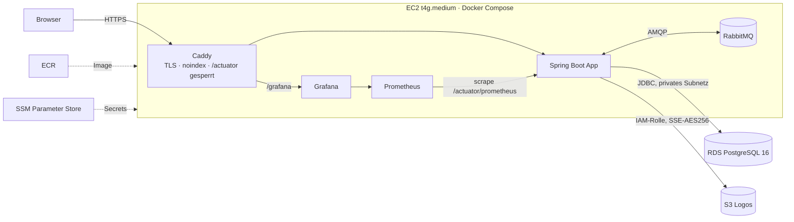
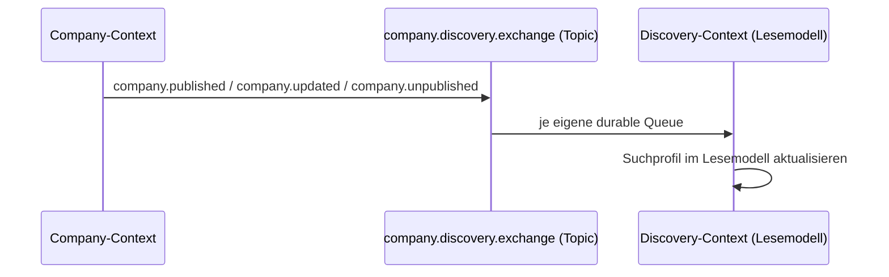
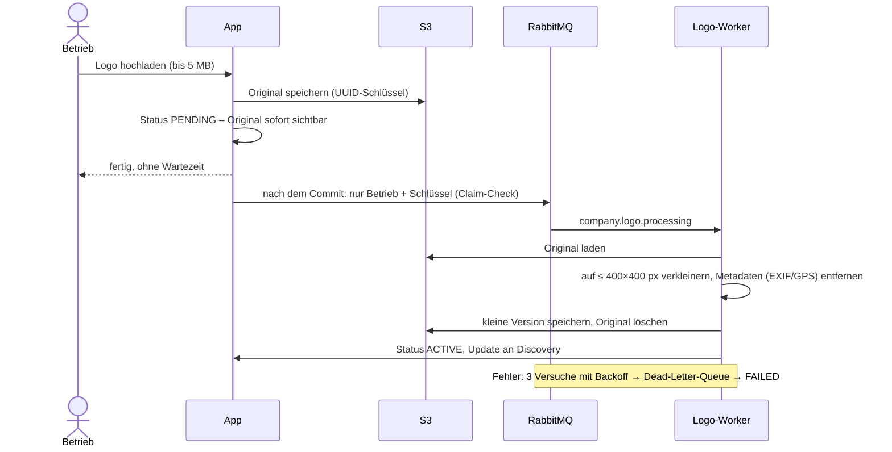
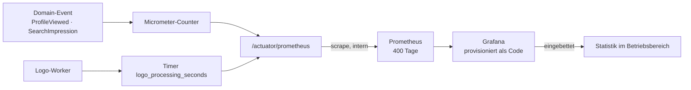

# Brennholz-Plattform: Cloud- und Messaging-Schaufenster

Ein Marktplatz, auf dem Kunden regionale Brennholz- und Baumpflegebetriebe finden und Betriebe ihr Profil pflegen.
**Dieses Repository ist ein kuratierter Auszug.** Er zeigt die Infrastruktur und die technischen Bausteine rund um
**Terraform, RabbitMQ, S3 und Prometheus/Grafana**. Fachlogik, Oberfläche und Produktstrategie bleiben im privaten Repository.
Der Auszug ist deshalb nicht allein lauffähig. Lauffähig ist die Live-Demo:

**Live-Demo:** https://federicofrank.com
Demo-Zugang Betriebsbereich: `demo@brennholz-demo.de` / `demo1234` (Profil, Logo-Upload, Sichtbarkeit, Statistik)

> Die Demo ist für Suchmaschinen gesperrt (`X-Robots-Tag: noindex`). Bewertungen und Badges sind als Beispielwerte gekennzeichnet.

**Stack:** Java 25 · Spring Boot 4.1 · PostgreSQL 16/PostGIS · RabbitMQ · AWS (EC2, RDS, S3, ECR, SSM) · Terraform · Docker Compose · Caddy · Prometheus · Grafana

---

## Architektur

Die Anwendung ist in **Bounded Contexts** geschnitten (hexagonal: Domain → Application → Ports → Adapter).
Contexts sprechen ausschließlich über **Integration Events** miteinander, nie über fremde Tabellen.

---

## 1. Terraform: [`infra/terraform`](infra/terraform)

| Modul | Inhalt |
|---|---|
| [`network`](infra/terraform/modules/network/main.tf) | VPC, öffentliche Subnetze (EC2), private Subnetze (RDS, ohne Internet), Security Groups: nur 80/443 offen, DB nur von der EC2 |
| [`compute`](infra/terraform/modules/compute/main.tf) | EC2 Graviton, IAM-Rolle mit minimalen Rechten, IMDSv2, kein SSH (SSM), Elastic IP, Auto-Recovery |
| [`database`](infra/terraform/modules/database/main.tf) | RDS PostgreSQL 16, verschlüsselt, nicht öffentlich |
| [`storage`](infra/terraform/modules/storage/main.tf) | Private Buckets: SSE-AES256, nur TLS, Block Public Access, Lifecycle |
| [`secrets`](infra/terraform/modules/secrets/main.tf) | Alle Passwörter zufällig erzeugt, SecureString in SSM, nichts im Code |
| [`registry`](infra/terraform/modules/registry/main.tf), [`budget`](infra/terraform/modules/budget/main.tf) | ECR mit unveränderlichen Tags und Lifecycle · Budget-Alarm |
| [`dns`](infra/terraform/modules/dns/main.tf) | Route-53-Zone der Domain; Hostname und Umleitungen (`www`, alte Adresse) kommen über SSM, ein Domain-Wechsel ist ein Redeployment ohne Neuaufbau |

**Kostenentscheidung:** Fargate + Load Balancer + NAT-Gateway hätte mit allen Diensten ~145 USD/Monat gekostet.
Eine EC2 mit Docker Compose, RDS und S3 kostet ~50 USD/Monat bei gleicher Funktion. ECS/Fargate ist die Ausbaustufe für echten Betrieb.

Releases: [`infra/scripts/release.sh`](infra/scripts/release.sh) baut das Image (arm64), pusht nach ECR und rollt per **SSM Run Command** aus.
Auf der Instanz holt [`deploy.sh`](infra/deploy/deploy.sh) Konfiguration aus S3 und Secrets aus SSM.

## 2. RabbitMQ: Event-Kette

- Publisher-Port und Adapter: [`CompanyEventPublisher`](src/main/java/com/baumexpert/brennholzdemo/company/profile/application/outbound/CompanyEventPublisher.java) → [`RabbitMQCompanyEventAdapter`](src/main/java/com/baumexpert/brennholzdemo/company/profile/infrastructure/messaging/discovery/RabbitMQCompanyEventAdapter.java)
- Vertrag: `*IntegrationEvent` (Company-Seite) und [`discovery/application/inbound`](src/main/java/com/baumexpert/brennholzdemo/discovery/application/inbound) (eigene Klassen auf Discovery-Seite, keine geteilten Typen)
- Topologie: [`CompanyEventPublisherConfig`](src/main/java/com/baumexpert/brennholzdemo/company/profile/infrastructure/messaging/discovery/CompanyEventPublisherConfig.java), [`DiscoveryMessagingConfig`](src/main/java/com/baumexpert/brennholzdemo/discovery/infrastructure/messaging/DiscoveryMessagingConfig.java), Consumer [`RabbitMqDiscoveryConsumer`](src/main/java/com/baumexpert/brennholzdemo/discovery/infrastructure/messaging/RabbitMqDiscoveryConsumer.java)

## 3. S3 und asynchrone Bildverarbeitung

Die Fallstricke dabei und wie sie gelöst sind:
- **Nicht auf die lokale Platte zwischenspeichern.** Container sind flüchtig, und mehrere Instanzen teilen keine Platte. S3 ist der Zwischenspeicher.
- **Erst nach dem Commit senden**, sonst liest der Worker womöglich einen alten Stand ([`AfterCommit`](src/main/java/com/baumexpert/brennholzdemo/company/profile/application/AfterCommit.java)).
- **Idempotent.** Doppelte oder veraltete Nachrichten ändern nichts.
- **Dauerhafte und vorübergehende Fehler werden getrennt behandelt.** Ein unlesbares Bild führt sofort zu `FAILED`, Netzwerk- oder DB-Fehler bekommen Retry und danach die Dead-Letter-Queue.

Code: [`CompanyLogoService`](src/main/java/com/baumexpert/brennholzdemo/company/profile/application/CompanyLogoService.java) (Use Case),
[`RabbitMQImageWorker`](src/main/java/com/baumexpert/brennholzdemo/company/profile/infrastructure/messaging/image/RabbitMQImageWorker.java),
[`ImageMessagingConfig`](src/main/java/com/baumexpert/brennholzdemo/company/profile/infrastructure/messaging/image/ImageMessagingConfig.java) (Queue, DLX, Retry),
[`ThumbnailatorLogoScaler`](src/main/java/com/baumexpert/brennholzdemo/company/profile/infrastructure/image/ThumbnailatorLogoScaler.java),
Speicher-Port [`FileStorageService`](src/main/java/com/baumexpert/brennholzdemo/storage/FileStorageService.java) mit [S3-](src/main/java/com/baumexpert/brennholzdemo/storage/S3StorageServiceImpl.java) und lokalem Adapter.
Tests: Unit-Tests und ein Integrationstest gegen LocalStack ([`src/test`](src/test/java/com/baumexpert/brennholzdemo)).

## 4. Prometheus und Grafana

- Events → Metriken: [`CompanyMetricsService`](src/main/java/com/baumexpert/brennholzdemo/company/analytics/CompanyMetricsService.java), [`PrometheusSearchMetricsAdapter`](src/main/java/com/baumexpert/brennholzdemo/discovery/infrastructure/metrics/PrometheusSearchMetricsAdapter.java)
- Scrape: [`prometheus.yml`](prometheus.yml) (lokal), [`infra/deploy/prometheus.yml`](infra/deploy/prometheus.yml) (Cloud)
- Grafana-Datenquelle und Dashboard als Code: [`grafana-provisioning`](grafana-provisioning)
- Absicherung: Von außen sperrt Caddy `/actuator`, Prometheus holt intern im Docker-Netz ab ([`Caddyfile`](infra/deploy/Caddyfile)).

---

## Bekannte Grenzen (bewusst für die Demo)
- Ein einzelner Server: kein Zero-Downtime-Deployment.
- Grafana-Dashboards sind anonym lesbar (nur Demo-Daten).
- Geschäftszahlen in Prometheus sind ein Demo-Kompromiss. Für echten Betrieb gehören sie in die Datenbank.
